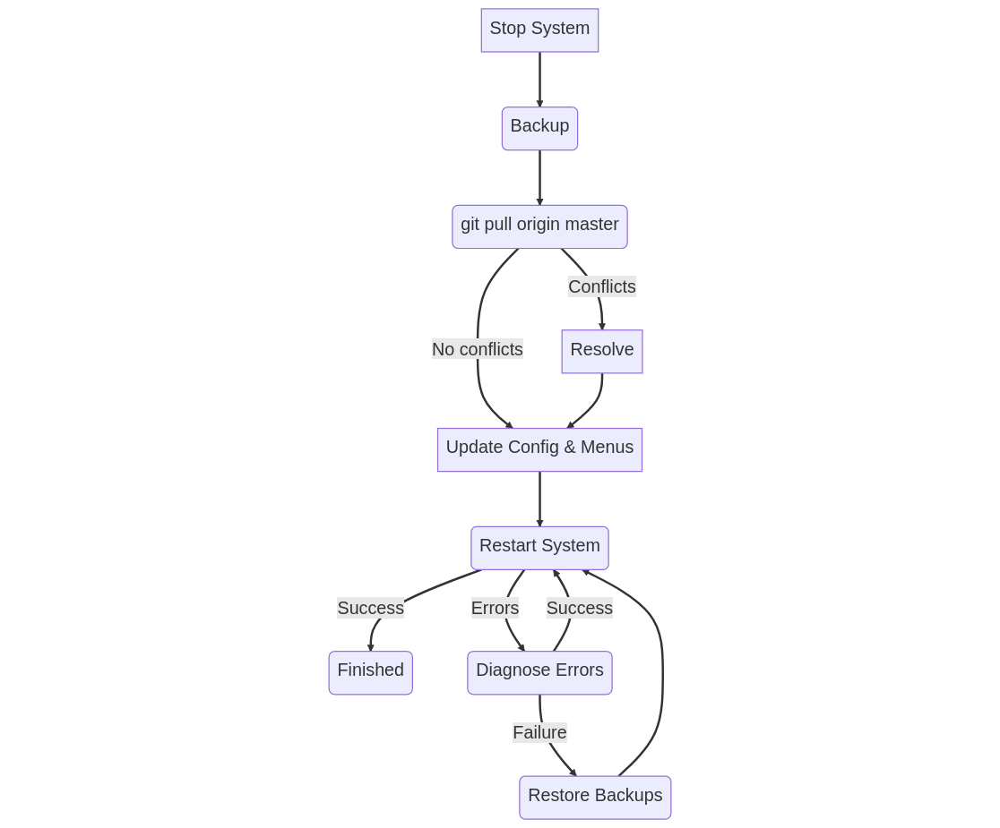

Keeping your system up to date gets you the latest fixes, features and general improvements.

ENiGMA½ is published as **releases**, tagged `vX.Y.Z` (`v0.7.0`, `v0.7.1`, ...), and as **`master`**, the edge, which carries every change as soon as it is merged. Most boards should run a release. See [Versioning & Releases](https://github.com/NuSkooler/enigma-bbs/blob/master/website/src/content/docs/contributing/versioning.md) for what a version number promises: a patch release (`0.7.0` to `0.7.1`) only fixes things; a minor release (`0.7.0` to `0.8.0`) adds features and is where anything that needs action from you appears.

## Before You Upgrade
1. **Back up your system.** See [Backing Up Your System](administration.md#backing-up-your-system).
2. **Read the [Upgrade Notes](upgrade-notes.md) for every version between yours and the one you are moving to**, not just the last one. Each **Action:** entry is something you need to do. [Release Notes](release-notes.md) covers what is new.
3. If the Upgrade Notes say the required Node.js version went up, install it first.

:::caution
ENiGMA½ upgrades its databases by itself when it starts, and only forward: an older version cannot read a database a newer one has upgraded. To go back to an older version after an upgrade, **restore your backup**. Checking out the old version alone is not enough.
:::

## Upgrading a Git Install
This covers the [install script](../installation/install-script.md), [manual](../installation/manual.md) and [Windows](../installation/windows.md) installs, which are all git checkouts.

```bash
# stop the system if it is running
cd enigma-bbs
# BACK UP YOUR SYSTEM, and read the Upgrade Notes
git fetch --tags
git checkout v0.7.1    # the release you are moving to
npm ci
# 1. look for any errors
# 2. update any configuration or menus (see below)
./main.js              # restart the system
```

`npm ci` installs exactly the packages the release was tested with, replacing `node_modules` as it goes, so there is no need to delete it by hand when Node.js changes. Git reports a "detached HEAD" after checking out a tag: that is expected.

If `git checkout` refuses because of local changes, you have edited files that ENiGMA½ ships (stock art or theme files, for example). Copy your changes aside, put the stock files back with `git checkout -- <file>`, and check out the release again. To avoid this next time, keep your customisations in your own files, such as a theme of your own, rather than editing the stock ones.

The release list, with each release's notes, is on [GitHub](https://github.com/NuSkooler/enigma-bbs/releases). `git tag --list 'v*'` shows the ones you have fetched.

Below is a visual representation of this process:


### Tracking master
If you want changes before they are released, run `master` instead:

```bash
cd enigma-bbs
git checkout master
git pull
npm ci
```

`master` is kept working, but it can carry unfinished features (switched off until they are done) and changes that have not been through a release's checks. The Upgrade Notes for changes merged since the last release are under **Unreleased**; read them each time you pull. To go back to releases, check out the next release once it is out. Checking out an *older* release than the `master` you ran may need your backup restored, as above.

## Upgrading a Release Archive Install
If you installed from a [release archive](../installation/release-archive.md), your configuration, databases and other data live inside the program directory. **Never unpack a new archive over an existing install**: it overwrites any stock file you have edited, and leaves behind files the new version removed.

Upgrade side by side instead:

1. Stop the system, back it up, and read the Upgrade Notes.
2. [Download and verify](../installation/release-archive.md) the new archive, and unpack it **next to** the old install, not into it.
3. Copy your data from the old directory into the new one:
    * `config/`, which holds `config.hjson`, your menus and `security/` keys. Leave out `config/achievements.hjson` unless you changed it: the release ships its own
    * `db/`
    * `file_base/`, and any other file area storage you set up inside the install
    * `logs/`, `mail/`, `userdata/` and `drop/`
    * your own mods in `mods/`. The release ships a few stock files there (`mods/themes/luciano_blocktronics/`), so don't copy those over the new ones
    * your own files in `www/` and `gopher/`, and `ws-term/` if you installed [enig-term](../servers/loginservers/enig-term.md)
    * any art or theme files you added under `art/`. Stock files you edited need merging with the new release's versions, not copying over them (see below)
4. In the new directory, run `npm ci` (or `npm ci --omit=dev`).
5. Merge in menu and theme changes as described below, then start the new version.

Keep the old directory until you are happy with the new one. If you set paths in `config.hjson` that point outside the install, those need no copying. If you changed paths to point *inside* the old install, update them.

## Upgrading Docker
Pull the image tag you run and recreate the container; your data is in its volumes. See [Docker](../installation/docker.md) for the tags and volumes. Back up and read the Upgrade Notes first, as for any other upgrade.

## Configuration File Updates
After an upgrade, **it is possible that your system is missing new features exposed in the default theme/menu layout**. To check this, you can look at the template menu files in `misc/menu_templates`, and `config_template.in.hjson` as well as the default `luciano_blocktronics/theme.hjson` files for changes/additions.

To see exactly what changed in the templates between two releases on a git install:

```bash
git diff v0.7.0 v0.8.0 -- misc/menu_templates misc/config_template.in.hjson art/themes/luciano_blocktronics/theme.hjson
```

### 💡Tips
* Create a clean install of the new version next to yours (a fresh checkout via `git clone https://github.com/NuSkooler/enigma-bbs.git enigma-bbs-clean`, or an unpacked release archive) and run it to see any new features within the default configuration!
* As the template files described above are likely what you built your system from, a visual diff viewer such as [DiffMerge](https://github.com/sourcegear/diffmerge/releases) (free, works on all major platforms) can be very helpful for the tasks outlined above!

:::tip
It is recommended to [monitor logs](../troubleshooting/monitoring-logs.md) and poke around a bit after an upgrade!
:::

## Which Version Am I Running?
Any of these shows it:

* `./main.js --version` or `./oputil.js --version`
* The [Waiting For Caller (WFC)](../modules/wfc.md) screen
* The `%VN` (and `%VL`) [MCI codes](../art/mci.md), wherever your art uses them
* The log, at startup

What the version means:

| Version | Means |
|---------|-------|
| `0.7.0` | Exactly that release: a git checkout of the `v0.7.0` tag, or a release archive or Docker image of it. |
| `0.7.0-14-gabc1234` | A git checkout 14 commits after `0.7.0`, at commit `abc1234`. You are tracking `master`, or another branch. |
| `0.6.3-beta-gabc1234` | A git checkout with no release tag in its history, at commit `abc1234`. You will see this on `master` until the first release is tagged. |
| `...-dirty` on any of these | Files that ENiGMA½ ships have been edited in your checkout. `git status` lists them. |

An install that is not a git checkout, such as a release archive, reports the version in its `package.json`. A Docker image reports the version it was built from.

## Something Went Wrong!
See [Installation & Upgrade Issues](../troubleshooting/installation-issues.md), which covers native module compile failures and the menu and theme entries an upgrade can leave behind.

If you need to go back to the version you had, restore your backup and check out (or unpack) that version again.
