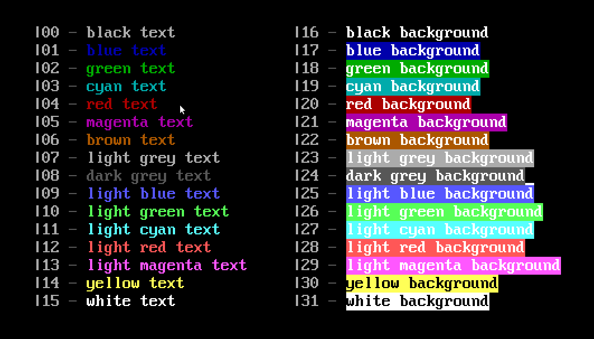

ENiGMA½ supports Renegade-style pipe colour codes for formatting strings. You'll see them used throughout your configuration, and can also be used in places like onelinerz, rumourz, full screen editor etc.

## Usage
When ENiGMA½ encounters colour codes in strings, they'll be processed in order and combined where possible.

For example:

`|15|17Example` - white text on a blue background

`|10|23Example` - light green text on a light grey background

Codes are upper case only: `|un` is just text. `|32` to `|99` are accepted and reset bold, nothing more.

## Other Pipe Codes
Strings in your configuration, menus and themes (prompts, view text, formats) accept a few more codes:

| Code | Meaning |
|------|---------|
| `\|\|` | A literal `\|`. Use it to show a pipe in front of something that would otherwise read as a code: `\|\|07` shows `\|07`. |
| `\|CF##` | Moves the cursor forward _##_ columns (one or two digits: `\|CF5`, `\|CF05`). `\|CB##`, `\|CU##` and `\|CD##` move it back, up and down. |
| `\|XY` | A [predefined MCI code](mci.md#predefined-codes), such as `\|UN` for the user's name, replaced by its value. |

Anything else after a `|` is shown as typed: an unknown `|ZZ`, a `|1A`, a lone `|`.

Text is padded, centred and cut to the columns it takes on screen: `a || b` is five columns wide, `|CF05` five, `|UN` as wide as the user's name, and an unknown `|ZZ` three, because it is shown as typed.

In a button's `itemFormat`, `{text}` is the button's text as drawn without the format: the format's codes render, and a pipe that is left in the text stays a pipe (it is not read as a code a second time).

### In Edit Fields
The full screen editor, and single-line fields that show colour as you type (such as the [sysop chat](../modules/sysop-chat.md) input line), take only the colour codes `|00` to `|99`; every other pipe is shown as typed, so `||` is two pipes there. A code you have just typed is shown as `|07` in its colour, and takes those three columns, until you move past it; then it collapses to its colour. Fields are measured in screen columns, so double-width characters take two.

### In Message Bodies
Messages and file descriptions take the colour codes above, the cursor codes (in ANSI messages; a plain message shows them as typed) and the PCBoard (`@X##`), Wildcat! (`@##@`), WWIV (`^C#`) and CNET colour codes. There is no `||` escape there: as on Renegade, Synchronet and Mystic, `||05` is a `|` followed by colour 05. When a message is exported (e-mail, NNTP, Gopher, ActivityPub, the REST API, the full screen editor's export), the codes are removed and anything shown as typed stays; `|CF05` becomes five spaces, but never more spaces than the code is long (`|CF99` also gives five), so an export is never longer than the message.

### Coming From Mystic or Renegade
* Mystic's `|PI` and `|CH|` (a literal pipe) are not codes here: use `||`. `|PI` is ENiGMA½'s MCI code for the bytes received since startup.
* Mystic's `|CL` (clear screen) is ENiGMA½'s MCI code for the system load, and `|CR` is not a code.
* In Renegade every `|` is a code introducer, so `||05` there is a pipe and colour 05. In ENiGMA½ configuration strings it is a literal `|05`; in message bodies it means what it means on Renegade.

## Colour Code Reference

:::caution
Colour codes |24 to |31 are considered "blinking" or "iCE" colour codes. On terminals that support them they'll
be shown as the correct colours - for terminals that don't, or are that are set to "blinking" mode - they'll blink!
:::

