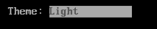

A spinner menu view displays one item at a time from a list, cycling through them in place. It is used to pick a single option from a set — a theme, a state, a protocol. Items are selected with the cursor keys or by a `hotKey`.

:::note
A spinner menu view is defined with a percent (%) and the characters SM, followed by the view
number if used. For example: `%SM1`
:::

:::note
See [Views](views.md) for the **common view properties**, the **common menu view
properties**, and the shared **Hot Keys** and **Items** reference — all of which
apply here.
:::

## Properties

Only the focused item is visible at any time, so `width` should be wide
enough for the longest item in the list (default 15).

In addition to the common menu view properties, a spinner menu view accepts:

| Property | Description |
|----------|-------------|
| `focusItemFrames` | Formats played in turn on the item shown, while the view has focus, with `focusItemFrameInterval`, `focusItemFrameDurations` and `focusItemFrameMode`. Up and down draw the next item's frame 0 at once. A frame wider than `width` is cut at the view's edge. Without focus the item is drawn as it would be without frames. See [Animated Focused Item](views.md#animated-focused-item) |

## Example



<details>
<summary>Configuration fragment (expand to view)</summary>

```hjson
SM1: {
  submit: true
  argName: themeSelect
  items: [
    {
      text: Light
      data: light
    }
    {
      text: Dark
      data: dark
    }
    {
      text: Rainbow
      data: rainbow
    }
    {
      text: Gruvbox
      data: gruvbox
    }
  ]
}

```

</details>
