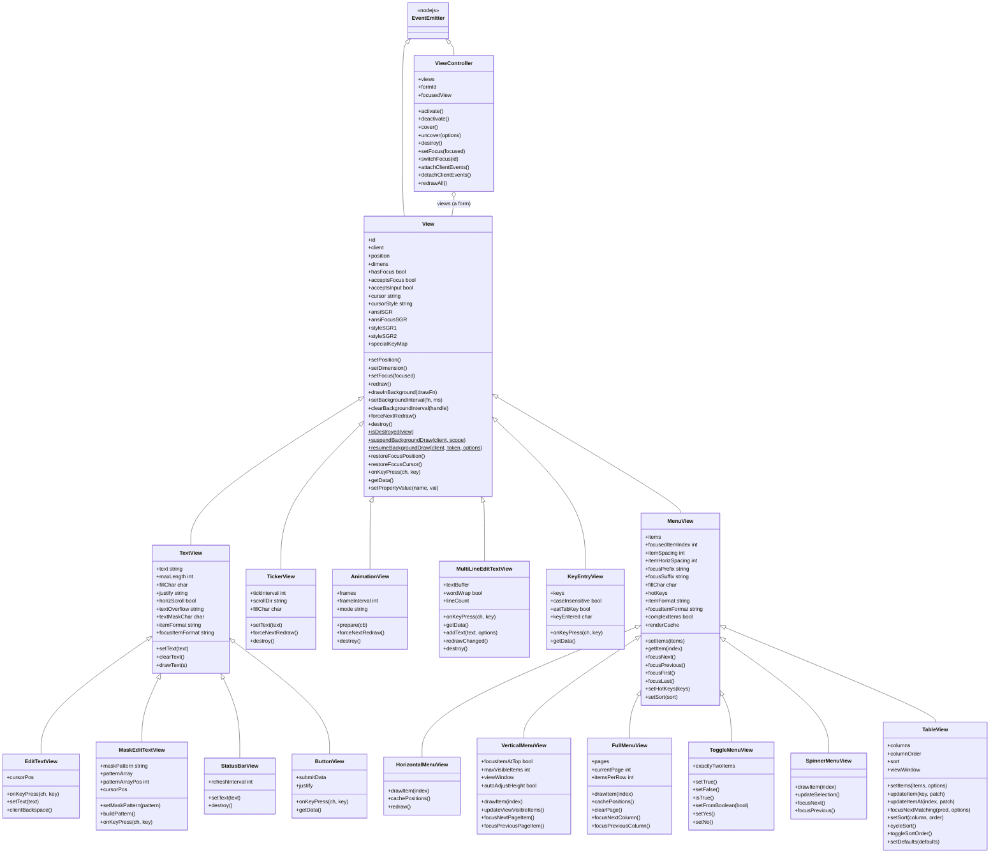
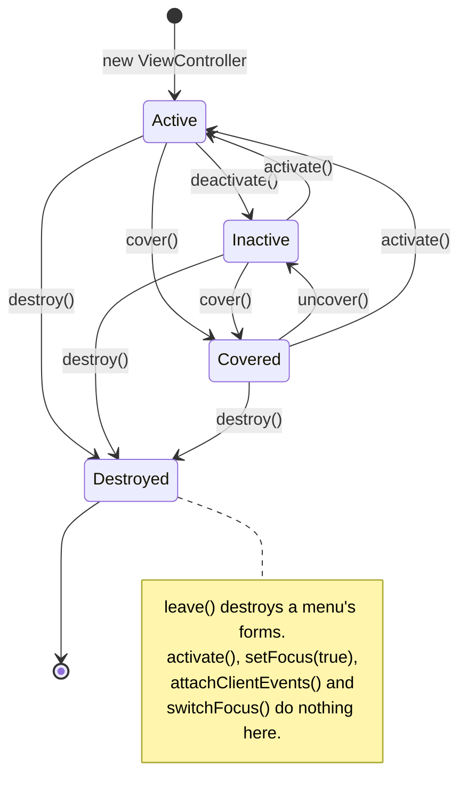

Views are the interactive and display widgets that make up ENiGMA½ screens. They are placed in art files using [MCI codes](../mci.md) and configured via `menu.hjson` and `theme.hjson`. Every element a user sees or interacts with — a text label, an input field, a menu list — is a view.

## General Information

:::note
Views are instantiated by placing an MCI code in an art file. The code determines the view type; an optional number suffix ties it to a specific view ID. For example: `%VM1` creates a Vertical Menu View with ID 1.
:::

:::note
Standard and focus colors are set by placing duplicate MCI codes back-to-back in the art file. The first occurrence sets the normal color, the second sets the focused color.
:::

:::note
See [MCI](../mci.md) for general information on MCI codes and the common configuration properties shared by all views.
:::

## Common View Properties

Every view accepts the following. Individual view pages document only what they
add on top of these.

| Property | Description |
|----------|-------------|
| `focus` | If set to `true`, this view receives initial focus when the screen loads |
| `submit` | If set to `true`, an `accept` action on this view will submit the enclosing **form** |
| `argName` | The key name used to identify this view's value in a submitted form |
| `width` | Width of the view in columns |
| `height` | Height of the view in rows (where applicable) |
| `justify` | Justification of content: `left` (default), `right`, or `center` |
| `fillChar` | Character used to fill space the content does not occupy. Defaults to a space |
| `textStyle` | Standard (non-focus) text style. See **Text Styles** in [MCI](../mci.md) |
| `focusTextStyle` | Text style when the view has focus. See **Text Styles** in [MCI](../mci.md) |
| `pauseWhenInactive` | If set to `true`, a view that draws on a timer (a `%TK` ticker, a `%SB` status bar with `refreshInterval`) skips its ticks while its form is inactive or covered, and is drawn again when the form is active. It only takes effect where a module deactivates or covers the form (the full screen editor's header, body and footers, a form under a `promptForInput()` prompt, the page not shown on a screen that switches pages; see [Form states](#form-states)). In the editor's view mode the header and body are inactive for the whole time, so a view there with `pauseWhenInactive` does not animate at all. By default such a view keeps drawing while its form is visible |

## Common Menu View Properties

The six **menu views** — [Horizontal](horizontal_menu_view.md),
[Vertical](vertical_menu_view.md), [Full](full_menu_view.md),
[Toggle](toggle_menu_view.md), [Spinner](spinner_menu_view.md) and
[Table](table_view.md) — all derive from the same base and therefore accept
everything above **plus** the following. The Table View does not support
`focusItems`, `itemSpacing` or `itemHorizSpacing`.

| Property | Description |
|----------|-------------|
| `items` | The list of items to show. See **Items** below |
| `focusItems` | An alternate list used when an item is focused, parallel to `items` |
| `itemFormat` | Format applied to a list entry. See **Entry Formatting** in [MCI](../mci.md) |
| `focusItemFormat` | Format applied to the focused list entry |
| `focusItemIndex` | Index of the item focused when the view is first drawn |
| `hotKeys` | Map of characters to item indexes. See **Hot Keys** below |
| `hotKeySubmit` | If `true`, selecting via a hot key also submits the form |
| `itemSpacing` | Blank rows (or columns, for horizontal layouts) between items |
| `itemHorizSpacing` | Horizontal spacing between items where the view lays out in columns |
| `textOverflow` | String used to indicate a truncated item, e.g. `"..."` |
| `sort` | Sort the items. `true` sorts on the displayed text, or supply a key name to sort on that field |

:::note
Both tables are derived from `View` and `MenuView` in `core/`, so anything listed
here works on every view of that kind — including combinations an individual
view's page does not show an example of.
:::

### Hot Keys

`hotKeys` lets a user press a character to select an item directly, and
`hotKeySubmit` submits the form when they do:

```hjson
hotKeys: { A: 0, B: 1, C: 2, D: 3 }
hotKeySubmit: true
```

This selects and submits the first item on `A`, the second on `B`, and so on.

### Items

Menu views take a list of items to display. The long form carries a `data` value
submitted with the form, separate from the `text` shown on screen:

```hjson
items: [
  {
      text: First Item
      data: first
  }
  {
      text: Second Item
      data: second
  }
]
```

If the list is display-only — no form action is attached to it — the `data`
element can be omitted and the items given as a plain list:

```hjson
items: [ "First item", "Second item", "Third Item" ]
```

---

## View Types

### Display Views

| View | MCI Code | Description |
|------|----------|-------------|
| [Text View](text_view.md) | `%TL` | A static single-line text label |
| [Ticker View](ticker_view.md) | `%TK` | A continuously scrolling marquee |
| [Status Bar View](status_bar_view.md) | `%SB` | An auto-refreshing text label |
| [Animation View](animation_view.md) | `%AV` | Frames played in a box over the menu's art |

### Input Views

| View | MCI Code | Description |
|------|----------|-------------|
| [Edit Text View](edit_text_view.md) | `%ET` | A single-line text input field |
| [Mask Edit Text View](mask_edit_text_view.md) | `%ME` | A single-line input field constrained by a pattern (e.g. dates, phone numbers) |
| [Multi Line Edit Text View](multi_line_edit_text_view.md) | `%MT` | A full multi-line text editor |
| [Button View](button_view.md) | `%BN` | A labeled button that triggers an action when activated |

### Selection / Menu Views

| View | MCI Code | Description |
|------|----------|-------------|
| [Horizontal Menu View](horizontal_menu_view.md) | `%HM` | A single-row horizontal list of selectable items |
| [Vertical Menu View](vertical_menu_view.md) | `%VM` | A scrolling vertical list, similar to a lightbar menu |
| [Full Menu View](full_menu_view.md) | `%FM` | A paginated multi-column grid of selectable items |
| [Toggle Menu View](toggle_menu_view.md) | `%TM` | A two-item toggle, typically used for Yes/No or On/Off choices |
| [Spinner Menu View](spinner_menu_view.md) | `%SM` | A single-item rotary selector that cycles through a list |
| [Table View](table_view.md) | `%TV` | A scrolling list with columns, group rows, an optional header and sorting |

---

## Class Hierarchy

The following diagram shows the inheritance relationships between all view types. All views ultimately extend Node.js's `EventEmitter` through the base `View` class.



---

## How Views Fit Together

Views are placed on screen via MCI codes in an art file. They are grouped into **forms** — a form collects input from one or more views and submits the result as a set of named key/value pairs (each view's `argName` maps to its `getData()` result).

The general flow is:

1. An art file is loaded and MCI codes are scanned to instantiate views
2. Views are configured from `menu.hjson` (per-entry `config`) and `theme.hjson` (styling)
3. Focus cycles through views that have `acceptsFocus: true`, driven by Tab / arrow keys
4. When a view with `submit: true` receives an `accept` action, the form is submitted
5. The submitted form data drives the next menu action or module behaviour

:::note
See [MCI](../mci.md) for details on formatting, text styles, and how MCI codes relate to menus and themes.
:::

### Views that load before the first draw

A view can have a `prepare(cb)` method for work that must be done before it is drawn, such as reading art. When a form loads, the `ViewController` calls `prepare()` on every view that has one, after the views are configured from `menu.hjson` and `theme.hjson` and before the form is first drawn, and draws the form once they have all called back. [AnimationView](animation_view.md) uses it to load its frames. `cb` takes no error: a view that cannot load what it needs logs it and draws what it can, so the menu still loads. A `prepare()` that throws is logged and costs only that view. If the form is torn down (its menu left) before every view has called back, it is not drawn. A form with no view that has `prepare()` loads exactly as before.

### Views that draw on a timer

A view that redraws on its own timer, as [TickerView](ticker_view.md) and a [StatusBarView](status_bar_view.md) with `refreshInterval` do, draws while the user may be typing into another view. Drawing moves the terminal cursor and leaves the drawing view's color set, and a text entry view echoes the next key wherever the cursor is, in whatever color is set. Use `setBackgroundInterval()` for the timer:

```js
this._timer = this.setBackgroundInterval(() => {
    this.setText(this._format, false); //  update the state: no drawing here
    if (this.text !== this._lastRendered) {
        this._lastRendered = this.text;
        return () => this.redraw(); //  what to draw, if anything
    }
}, this.refreshInterval);
```

`setBackgroundInterval(fn, ms)` calls `fn()` every `ms`. `fn` updates the view and returns a function that draws the change, or nothing when there is nothing to draw; that function is run through `drawInBackground()` (below). It returns the timer's handle, or `null` on a view that has already been destroyed (no timer is started). `destroy()` clears every background interval the view has, so a view whose form is torn down stops on its own; `clearBackgroundInterval(handle)` stops one sooner (a changed interval, say). A timer of your own (`setInterval()`) works too: draw from it through `drawInBackground()`, and clear it in your `destroy()`.

A view with a timer, a listener or anything else that outlives a draw overrides `destroy()` to stop it, and calls `super.destroy()`: the base `destroy()` clears the background intervals and marks the view destroyed (`View.isDestroyed(view)`), so no redraw is owed to it after a cover. A view that does not override `destroy()` gets the base one, which is enough for background intervals. `destroy()` may be called more than once; make yours safe to repeat.

`drawInBackground(drawFn)` hides the cursor, runs `drawFn`, then calls `restoreFocusCursor()` on the view that has input focus (the view last given focus, on any of the screen's forms), and sends it all in one write; if `drawFn` throws, the cursor is still put back before the error goes on to the caller. `restoreFocusCursor()` calls `restoreFocusPosition()`, which puts the cursor and color back where that view echoes its next key, then shows or hides the cursor as the view's `cursor` property says. `EditTextView` returns to its edit position, `MultiLineEditTextView` (the full screen editor) to its edit row and column, `TextView` and its subclasses to where `setFocus(true)` leaves the cursor; the base `View` does not move it. Override `restoreFocusPosition()` in a focusable view that knows where its cursor belongs. A menu module's `updateCustomViewTextsWithFilter()` uses the same `restoreFocusPosition()` after redrawing custom views. When no view has focus the cursor is left where `drawFn` leaves it. A pause prompt waiting for its key counts as that: it sets the input focus aside while it waits (`View.suspendInputFocus(client)`, given back with `View.resumeInputFocus(client, token)`), so a ticker in the pause art leaves the cursor alone even when a menu form under the pause still has a focused field. Use the same pair around anything else that takes the screen without taking typing.

While art is drawn with baud emulation (a drip: `dripWrite()` and the like), background drawing is paused for every view that was already there when the art started, as it is under a cover (below): a tick drawn between two pieces of the art would move the cursor the art carries on from. A view that missed a draw is drawn once when the art is done. Other output during the art goes out at once, as it always has.

`drawFn` should only draw. Change the view's state (add a line, advance a frame) before calling `drawInBackground()`, not inside `drawFn`: while the screen is covered (below), `drawFn` still runs but its output is thrown away, and a terminal that cannot discard output skips it.

### When something covers the screen

A realtime interrupt, a help page (the full screen editor's Ctrl-O help, the file list's and the WFC's) and a pause prompt that clears the screen are drawn over a menu whose forms are still attached. While one is up (for a clear-screen pause, while it waits for its key):

* **Background drawing is paused** for the views that existed when the cover began, so a ticker or status bar under it does not draw over it. A view that would have drawn meanwhile gets one full redraw when the cover ends (unless the menu is about to repaint anyway, as a reload after an interrupt does). Before that redraw, `forceNextRedraw()` is called on the view: override it in a view that skips output it believes is already on screen. `TickerView` does, so an unchanged frame is drawn again after a cover.
* **Views created inside the cover keep drawing.** A ticker in a pause prompt shown over an interrupt (the stock `pausePage` has one) animates while the menu's ticker under it waits, and so does a form a module builds inside its own `coverScreen()`. The exception is an interrupt: it covers the interrupted menu's forms by ownership (scope `{ menu }`, below), so a form that menu builds while the interrupt is up (its art finished loading) does not draw over it either. `coverScreen()` does the same when given `scope: { menu: this }`.
* **Keys go to the cover,** not to the forms under it, for an interrupt or a help page: the key that dismisses it is not typed into a field or run as an action underneath. See [Input capture](#input-capture). A pause prompt (one that clears the screen, or one on the same screen) is a plain `client.waitForKeyPress()` and takes no keys from the forms: its key reaches them too, as it always has.

A clear-screen prompt that does not pause (one that takes input, such as an `ET` field) suspends nothing: once it is drawn, the module showing it owns the screen, as before.

For views of your own, `View.suspendBackgroundDraw(client, scope)` returns a token and `View.resumeBackgroundDraw(client, token, { redrawMissed })` gives it back. Suspends nest. `redrawMissed: false` skips the redraw when you replace the screen next. Most code wants `coverScreen()` instead, which does both this and input capture (see [Covers and input capture](../../modding/menu-modules.md#covers-and-input-capture)).

`scope` says which views a suspend covers:

| `scope` | Covers |
|---------|--------|
| none (the default) | Every view that exists when the suspend is taken. A view created later (a ticker in the cover's own pause prompt, a form built inside the cover) draws. With suspends nested, the most recent one decides. Drips and `coverScreen()` (unless given a `scope`) use this. |
| `{ menu }` | The same, plus every view on a form of `menu` (a form in its `viewControllers` when the view would draw, whether it got there through `addViewController()` or was assigned directly), whenever it was created. Views on no menu's form (a theme's temporary prompt form, a mod's bare view) follow the default rule. Interrupts use this, and `coverScreen({ scope: { menu: this } }, ...)`. |
| `{ forms: [ vc, ... ] }` | Only the views of those forms. Nothing else on the screen is affected. `vc.cover()` uses this. |

A view whose state changes outside a timer, such as a chat log filled by lines arriving from a server, adds the text without drawing and draws from `drawInBackground()`. `MultiLineEditTextView` has a pair for this:

```js
chatLogView.addText(line, { scrollMode: 'end', redraw: false });
chatLogView.drawInBackground(() => chatLogView.redrawChanged());
```

`addText(text, { redraw: false })` changes the text only; `redrawChanged()` draws the rows that changed since the view was last drawn (all of it if it scrolled). Lines that arrive while the screen is covered are kept, and drawn when it is uncovered.

### Input capture

While something owns the screen, it can own the keys too. `client.captureInput(handler, options)` makes `handler(ch, key)` the receiver of every key and returns a token; `client.releaseInput(token)` gives the keys back. While any capture is held, only the newest one gets keys, and no form's key handler runs: the forms stay attached, they just see nothing. `client.hasInputCapture()` says whether a capture is held. Direct `key press` listeners on the client (a door's own key handling) still see every key, as before.

`options`:

| Option | Description |
|--------|-------------|
| `onMenuChange` | What happens to the capture if the caller is moved to another menu while it is held (a sysop break-in, a time-up). `'passThrough'` (the default): the handler keeps getting every key, alongside the new menu, until you release it. `'drop'`: the capture is dropped and the handler never called (what a cover's own capture does). |
| `onDrop` | Called if the capture is dropped rather than released (the caller hung up, or `'drop'` above). The handler will never be called; clean up here. |

`client.waitForKeyPress(cb)` is not a capture. It is a plain `once('key press')`, as it always was: `cb(ch, key)` gets the next key, in the order the listeners were added, and that key also reaches every other listener, including a form still attached under whatever is waiting. Several waits pending at once all get the same key. To keep the key from the forms, wait inside a cover (`coverScreen()`, see [Covers and input capture](../../modding/menu-modules.md#covers-and-input-capture)), whose capture silences them for every key until it ends, including the one that ends it; or take a capture of your own.

A capture taken while a key is being delivered (a form's action opens a help page) is for the next key; the listeners after it still see the current one.

### Form states

A form (a `ViewController` and its views) is in one of four states:

| State | Call | Keys | Views and their listeners | Background drawing |
|-------|------|------|---------------------------|--------------------|
| Active | `vc.activate()` | yes | live | runs |
| Inactive | `vc.deactivate()` | no | live, listeners kept | runs, except views with `pauseWhenInactive` |
| Covered | `vc.cover()` / `vc.uncover({ redraw })` | no | live | paused; missed draws are made up on `uncover()` |
| Destroyed | `vc.destroy()` | no | listeners removed, views destroyed | stopped, for good |



When to use which:

* **`deactivate()` / `activate()`**: another form on the same screen takes the keys for a while, and this one stays visible as it is (the editor's header while the body is being typed into). A ticker on it keeps running: on screen means animating. Nothing is torn down, so listeners you added to its views are still there afterwards; do not add them again on `activate()`.
* **`cover()` / `uncover()`**: something is drawn over this form (a prompt drawn over part of it, another form's art) and then removed. Its views stop drawing in the background so they do not draw over what covers them; `uncover()` draws each view that missed a draw once, or every view with `{ redraw: true }` when what covered the form overlapped all of it. On a form that is not covered, `uncover()` does nothing, `{ redraw: true }` included. `uncover()` leaves the form inactive; `activate()` uncovers and gives it the keys. Other forms on the screen keep drawing (a timer-drawn view on them may draw its whole frame once instead of only what changed): for the whole screen, use a cover (`coverScreen()`, above). The form holds its suspend until `uncover()`, `activate()`, `attachClientEvents()`, `destroy()` or a teardown (`setFocus(false)`, `detachClientEvents()`). A covered form that is simply dropped keeps it until the next menu change, which drops every suspend; it only ever pauses that form's views.
* **`MenuModule.promptForInput({ prevFormName })`** covers the form named `prevFormName` while its prompt is up, and activates it again when the prompt is submitted (only the views that missed a draw are drawn again). Its views and their timers are kept, so a ticker under the prompt pauses rather than stopping. Its view listeners are removed when the prompt opens, as they always were, so a module adds them again in the prompt's actions.
* **`destroy()`**: the form is finished with. This is terminal: a destroyed form cannot be attached again. `MenuModule.leave()` destroys every form still in the menu's `viewControllers`, so a callback that finishes after the caller has left the menu (art that finished loading, a database read, a line from a chat server) and calls `setFocus(true)` or `switchFocus()` on one of its forms does nothing (a debug log line says so). The keys stay with the menu now on screen. A new instance of the menu (a reload, coming back to it) has new forms and is not affected.

`setFocus(true)` is `activate()`. **`setFocus(false)` is unchanged**: it detaches the form and tears it down (`detachClientEvents()`: listeners removed, views destroyed, their timers stopped), though the form is not marked destroyed and `setFocus(true)` attaches it again, as before. `detachClientEvents()` keeps that meaning too, and is deprecated in favour of `destroy()`, or `deactivate()` / `cover()` for a form that will be shown again. **`removeViewController(name)` is unchanged** too: it detaches the form (`detachClientEvents()`, which leaves a form that never attached as it is) and forgets it, without destroying it, so a module that kept the form can add it back and attach it again.

"Inactive" means `deactivate()` or `cover()` was called on the form. A form built `detached` and never attached is not inactive. `attachClientEvents()` on an inactive or covered form (also through `switchFocus()`) makes it active again: it uncovers the form and gives it the keys. Unlike `activate()`, it does not focus the focused view again or redraw paused views; `switchFocus()` focuses its target, so prefer `activate()` or `switchFocus()`.

A view with `pauseWhenInactive: true` that draws on a timer (`setBackgroundInterval()`: `%TK`, `%SB` with `refreshInterval`) skips its ticks while its form is inactive or covered: its timer callback is not called, so a ticker does not move on unseen. A redraw owed to it still draws it (the end of a cover, `uncover()`, `uncover({ redraw: true })`), and `activate()` draws it once more if it skipped a tick. It only takes effect where a module calls `deactivate()` or `cover()`.

The stock modules use these states where a form loses the keys and is shown again:

* The full screen editor deactivates the header, body and footer forms that stay on screen while another one has the keys (the header while you type the message, the body while the Escape menu or find is open, both in view mode). The footers take turns in the rows below the body: the one not shown is covered. The quote builder covers the body and the menu; it is covered itself when it closes, as is the find footer.
* A form under a `promptForInput()` prompt is covered (the message list's delete confirmation, the WFC kick confirmation). So is the WFC task screen under its run / stop prompt.
* The pre-auth feedback editor and the ActivityPub message viewer deactivate their bodies, which stay on screen.
* Screens that switch between pages of one menu cover the page not shown, before the other page's art is drawn, and activate it when it is shown again (as before, its art is drawn and its focused view; views that missed a draw while it was covered are drawn too): onelinerz and rumorz (view and add), the BBS list (list and add), the file list (browse, details, and the sections under the details nav) and the ActivityPub search, actor search and user configuration screens. Their listeners on the hidden page's views are kept, and added once.
