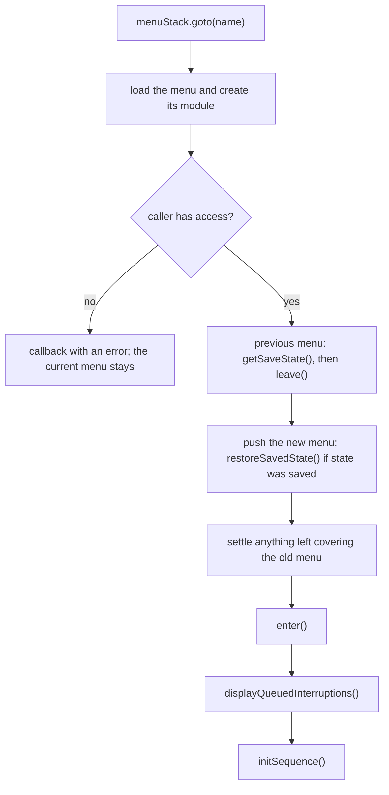
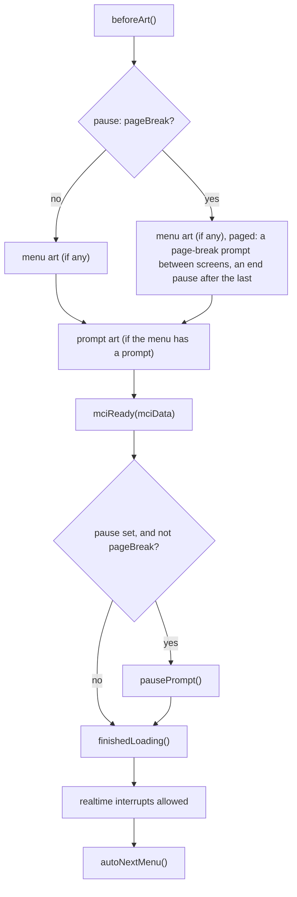
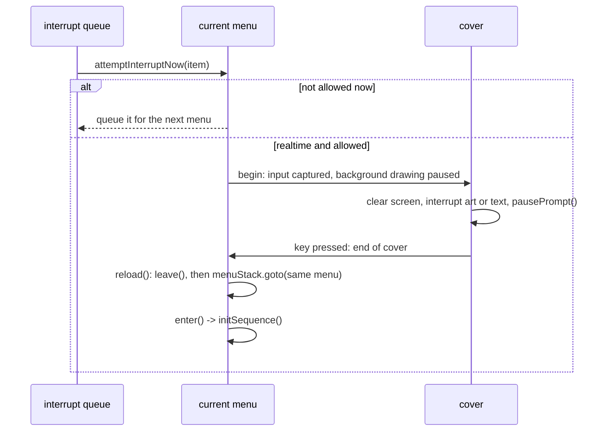

From initial connection to the screens and mods your users interact with, the entire experience is made up of menu entries — And all menu entries found within [menu.hjson](../configuration/menu-hjson.md) are backed by *Menu Modules*. For basic menus, a standard handler is implemented requiring no code. However, if you would like to create a menu that has custom handling, you will very likely be inheriting from from `MenuModule`. More on this below.

:::note
Remember that ENiGMA does not impose any stucture to your system! The "flow" of all `menu.hjson` entries is up to you!
:::

:::tip
If the `module` entry is not present in a `menu.hjson` entry, the system automatically uses [standard_menu.js](https://github.com/NuSkooler/enigma-bbs/blob/master/core/standard_menu.js). For the modules ENiGMA½ already ships with, see [Built-in Modules](../modules/index.md).
:::

## Creating a New Module
At the highest level, to create a new custom menu or mod, inherit from `MenuModule` and expose it via the `getModule` exported method:

```javascript
// my_fancy_module.js
exports.getModule = class MyFancyModule extends MenuModule {
  constructor(options) {
    super(options);
  }
};
```

Next, override the appropriate methods to add some functionality! Below is an example fragment overriding just `initSequence()`:

```javascript
initSequence() {
    async.series(
        [
            callback => {
                // call base method
                return this.beforeArt(callback);
            },
            callback => {
                // a private method to display a main "page"
                return this._displayMainPage(false, callback);
            },
        ],
        () => {
            this.finishedLoading();
        }
    );
}
```

:::tip
Remember that *all* menus within ENiGMA are created by inheriting from `MenuModule`. Take a look at existing examples such as [WFC](https://github.com/NuSkooler/enigma-bbs/blob/master/core/wfc.js), [NUA](https://github.com/NuSkooler/enigma-bbs/blob/master/core/nua.js), [MRC](https://github.com/NuSkooler/enigma-bbs/blob/master/core/mrc.js) and more!
:::

### ModuleInfo
To register your module with the system, include a `moduleInfo` declaration in your exports. The following members are available:

| Field | Required | Description |
|-------|----------|-------------|
| `name` | Yes | Short name of the module |
| `desc` | Yes | Long description of this module |
| `author` | Yes | Author(s) of module |
| `packageName` | No | Defines a reverse DNS style package name. Can be used in conjunction with the `getModDatabasePath()` call form [database.js](https://github.com/NuSkooler/enigma-bbs/blob/master/core/database.js) to interact with a database specific to your module (See example below) |

**Example**:

```javascript
exports.moduleInfo = {
  name: 'Super Dope Mod',
  desc: '...a super dope mod, duh.',
  author: 'You!',
  packageName: `com.myname.foo.super-dope-mod`,
};
```

### Per-Mod Databases
Custom mods often need their own data persistence. This can be achieved with `getModDatabasePath()` and your `moduleInfo`'s `packageName`.

**Example**:
```javascript
self.database = getTransactionDatabase(
    new sqlite3.Database(getModDatabasePath(moduleInfo), callback)
);
```

Given the `packageName` above, a database will be created at the following location:
```bash
$enigma-bbs/db/mods/com.myname.foo.super-dope-mod.sqlite3
```

### Menu Methods
Form handler methods specified by `@method:someName` in your `menu.hjson` entries map to those found in your module's `menuMethods` object. That is, `this.menuMethods` and have the following signature `(formData, extraArgs, cb)`. For example, consider the following `menu.hjson` fragment:

```hjson
actionKeys: [
  {
    keys: [ "a", "shift + a" ]
    action: @method:toggleAvailable
  }
]
```

We can handle this in our module as such:
```javascript
exports.getModule = class MyFancyModule extends MenuModule {
  constructor(options) {
    super(options);

    this.menuMethods = {
      toggleAvailable: (formData, extraArgs, cb) => {
        // ...do something fancy...
        return cb(null);
      }
    };
  }
}
```

## MenuModule Lifecycle
Methods shown with `()` in their name such as `enter()` are overridable when inheriting from `MenuModule`.

### Going to a menu
Every move between menus (`gotoMenu()`, `prevMenu()`, `nextMenu()`, a `@menu:` action, a reload) goes through the client's menu stack:



* `leave()` of the menu being left runs before the new menu's `enter()`. The default detaches and destroys the menu's forms (`detachViewControllers()`). It also runs when the caller disconnects, so it is a module's one chance to clean up (timers, temp files, node counts).
* `enter()` is called with no callback. The default shows any queued interruptions (`displayQueuedInterruptions(callback)`, skipped with `interrupt: never`), then calls `initSequence()`. If you override `enter()`, call `super.enter()`.
* If the caller was moved on while something covered the old menu (a sysop break-in or a time-up during a pause or an interrupt), what that cover held is settled first: its paused background drawing is dropped, and a pending `waitForKeyPress()` gets the next key without keeping it from the new menu, as it always did.

### initSequence()
The default `initSequence()`, which most modules keep:



* `beforeArt(callback)` is called before any art is displayed. The default implementation clears the screen if requested by the menu's `config` block (`cls: true`). Baud rate emulation, if configured, is applied during the art display itself rather than here.
* `mciReady(mciData, callback)` is called when art is loaded and MCI codes are initialized. The default implementation of a custom `MenuModule` simply continues. See also [standardMCIReadyHandler](#standardmcireadyhandlermcidata-callback).
* With `pause: pageBreak`, the menu art is shown a screen at a time, with a page-break prompt between screens and an end-of-art pause after the last one (skipped if the caller quits); art that fits on one screen, or positions itself (native or RIP art), is shown without either. The pause step after `mciReady()` is then skipped. Any other `pause` value (`true`, `end`, a prompt name) gets one `pausePrompt()` below the art in that step.
* `finishedLoading()` does nothing in the base class. Right after it returns, the default `initSequence()` marks a menu with `interrupt: realtime` as interruptible. Calling `finishedLoading()` does not do that itself.
* `autoNextMenu()` moves on by itself only when the menu has `runtime.autoNext` (after `nextTimeout`, if set).
* If a step fails, `initSequenceFailed(err)` goes back to the previous menu. Menu art that cannot be shown is not a failure; prompt art that cannot be shown is.

A module that overrides `initSequence()` (see [Creating a New Module](#creating-a-new-module)) runs only what it calls. It is not made interruptible by calling `finishedLoading()`, so on such a menu realtime interrupts stay queued.

### Realtime interrupts
On a menu with `interrupt: realtime`, an interrupt that arrives (a node message, a page, an achievement) once the default `initSequence()` has finished loading (after `finishedLoading()`) is shown at once. Before then, on a menu that overrides `initSequence()`, or on a menu set to `queued`, it is queued for the next menu's `enter()`.



While the interrupt is up, the menu's forms stay attached but get no keys, and its tickers and status bars do not draw over it. A ticker in the pause prompt still animates. The key that dismisses the interrupt does not reach the menu. A module can override `attemptInterruptNow(interruptItem, cb)` to hold interrupts back, calling `cb(null, false)` to leave the item queued.

### Covers and input capture
Sometimes a module shows something over its own screen and then gives the screen back: a help page, a message, a confirmation. Its forms are still attached underneath. Pick by what the screen does:

* **Over the whole screen, then back** (a help page): use `this.coverScreen(options, fn, cb)`. While `fn(done)` runs, keys go only to the cover (a `client.waitForKeyPress()` inside it gets its key) and the forms' tickers and status bars do not draw. Call `done(err)` when finished; `options.restore(cb)` then repaints your screen, before input and drawing are given back. Views that missed a draw get one redraw unless `redrawMissed: false`.

  ```javascript
  displayHelp(cb) {
      this.coverScreen(
          { restore: done => this.redrawMyScreen(done) },
          done => {
              this.displayAsset(this.menuConfig.config.art.help, { clearScreen: true }, () => {
                  this.client.waitForKeyPress(() => done(null));
              });
          },
          cb
      );
  }
  ```

  The same helper is `coverScreen(client, options, fn, cb)` in `core/screen_cover.js`, for code that is not a menu module.

* **Your own key handling for a while,** with nothing covered (a "press Y or N" read by code, a key-driven mini screen): use `client.captureInput(handler, options)` and `client.releaseInput(token)`. The forms get no keys while you hold it. See [Input capture](../art/views/views.md#input-capture).
* **A pause on the same screen,** drawn under the menu's art: `pausePrompt()` (or `client.waitForKeyPress()`) on its own. The key that ends it is not passed to the forms, and the tickers and status bars on screen keep animating.

A prompt shown with `clearScreen` (`promptForInput()`, `displayThemedPrompt()`) also pauses the background drawing of the screen under it while it is up.

## MenuModule Helper Methods
Many helper methods exist and are available to code inheriting from `MenuModule`. Below are some examples. Poke around at [menu_module.js](https://github.com/NuSkooler/enigma-bbs/blob/master/core/menu_module.js) to discover more!

### Views & View Controller
#### `displayAsset(name | Buffer, options, callback)`:
Display an asset by `name` or by supplying an `Buffer`.
`options` is an optional Object with any of the following properties:
* `clearScreen` (Boolean): Should the screen be cleared first?
* `encoding` (String): Encoding of `Buffer` if used. Defaults to `cp437`.
* `font` (String): SyncTERM style font to use.
* `trailingLF` (Boolean): Should a trailing LF be allowed?
* `startRow` (Number): Row in which to start drawing at

#### `prepViewController(name, formId, mciMap, callback)`:
Prepares the menu's View Controller for a form of `name` and `formId` using the supplied `mciMap`. `callback` has the following siguature: `(err, viewController, created)` where `created` is `true` if a new View Controller was made.


* `prepViewControllerWithArt()`
* `displayArtAndPrepViewController()`
* `setViewText()`
* `getView()`
* `updateCustomViewTextsWithFilter()`
* `refreshPredefinedMciViewsByCode()`

### Validation
* `validateMCIByViewIds()`
* `validateConfigFields()`

### Date/Time Helpers
The following methods take a single input to specify style, defaulting to `short`. If your menu or theme `config` block specifies a cooresponding value such as `dateFormat` or `dateTimeFormat`, that value will be used, else standard fallbacks apply:
* `getDateFormat()`
* `getTimeFormat()`
* `getDateTimeFormat()`

### Misc
* `promptForInput()`


#### `standardMCIReadyHandler(mciData, callback)`:
This is a standard and commonly used `mciReady()` implementation:

```javascript
mciReady(mciData, cb) {
  return this.standardMCIReadyHandler(mciData, cb);
}
```

Where `mciData` is a Object mapping [MCI codes](../art/mci.md) such as `TL2` to their properties:
* `SGR`: Graphics rendition
* `focusSGR` (Only present if art contained both, ie: `TL2^[0;mTL2`)
* `position` (Array of Number): Position in [Row, Column] order
* `args` (Array): Any arguments to the MCI code
* `code` (String): The code itself, such as `TL`
* `id` (Number): The MCI code's ID such as `1`

:::note
Search the code for the above methods to see how they are used in the base system!
:::


### Default custom info formats
Art places custom views `%TL10`, `%TL11`... (up to 99) that a module fills with `updateCustomViewTextsWithFilter(formName, startId, fmtObj)`. Their formats come from the menu's `config` as `${formName}InfoFormat${id}`, e.g. `mainInfoFormat10`. To make a mod work with no operator config, override `getDefaultCustomInfoFormats(formName)` and return the defaults keyed by view ID:

```javascript
getDefaultCustomInfoFormats(formName) {
    return 'main' === formName ? { 10: '{msgCount} new', 11: '{userName}' } : {};
}
```

* An operator's `config` (or theme) entry always wins over a default.
* Setting an entry to an empty string, `null` or `false` (`mainInfoFormat10: ""`) hides that view even though the module has a default for it. For a module without a default, either is the same as not setting it.
* Never write defaults into `this.menuConfig.config`: it is the shared, cached theme object. `getCustomInfoFormat(formName, id)` is the lookup, and `getCustomViewsWithFilter()` (including its `filter` option) and `updateCustomViewTextsWithFilter()` both use it.

## Custom Mods
Most mods will also derive from `MenuModule`. Some things to be aware of:
* Custom mods that bring in their own dependencies must also include their own `package.json` and other Node requirements
* Be sure to use `packageName` and `getModDatabasePath()` for any (database) peristence needs.
* Custom mods in `mods/the_mod_name/` and the `MenuModule` entry point must be within a file of the same name: `mods/the_mod_name/the_mod_name.js`
* To import ENiGMA modules `require()` from `../../core/`

### Shipping art with a mod
A mod kept in its own folder can ship its art in an `art` folder beside its code, and its menus name that art by plain name:

```
mods/the_mod_name/the_mod_name.js
mods/the_mod_name/art/MYMOD.ANS
mods/the_mod_name/art/MYMODHLP.ANS
```

```hjson
myModMenu: {
    module: @userModule:the_mod_name
    art: MYMOD
    config: {
        art: {
            help: MYMODHLP
        }
    }
}
```

For a menu whose `module` is that mod, art is looked for in the user's theme, then the default theme, then `mods/the_mod_name/art/`, then `art/general` (see [General Art Information](../art/general.md#art-spec)). So the operator needs to copy nothing, the art updates with the mod, and an operator who wants a different look drops a file of the same name (`MYMOD.ANS`) into their theme, as for any other art. Everything that works in a theme folder works in the mod's: random selection (`MYMOD1.ANS`, `MYMOD2.ANS`, ...), UTF-8 variants, native `.seq` / `.ata` art and `.rip` art for RIP callers. The folder is yours and the operator's, as trusted as a theme.

Some things to know:
* Only plain names are looked for there: an art name holding a path (`art/foo/MYMOD.ANS`) means exactly that file, as before.
* Only a mod in its own folder has one. A single file mod (`mods/the_mod_name.js`) shares `mods/` with every other mod and has no art folder: its art goes in a theme or `art/general`.
* Art the menu shows through `MenuModule` gets the fallback: the menu's `art` and its `prompt`, `displayAsset()`, `prepViewControllerWithArt()` and `displayArtAndPrepViewController()` (`config.art.<name>`), paged art, and prompts shown with `promptForInput()`. Pause prompts are shared system screens and do not, even one a menu names with `pausePrompt`: for its own pause art, a mod's README should have the operator add a prompt with that art in their theme (or `art/general`) and set the menu's `pausePrompt` to it (see [Pause Prompts](../art/pause-prompts.md)). Code that calls `core/theme.js` directly can pass `modArtPath: this.modArtPath` in its options to get the same.
* Pick names that are unlikely to clash with other art: a theme's file of the same name always wins, and the mod's file wins over one in `art/general`.
* A missing `art` folder is fine: the lookup moves on to `art/general`.
