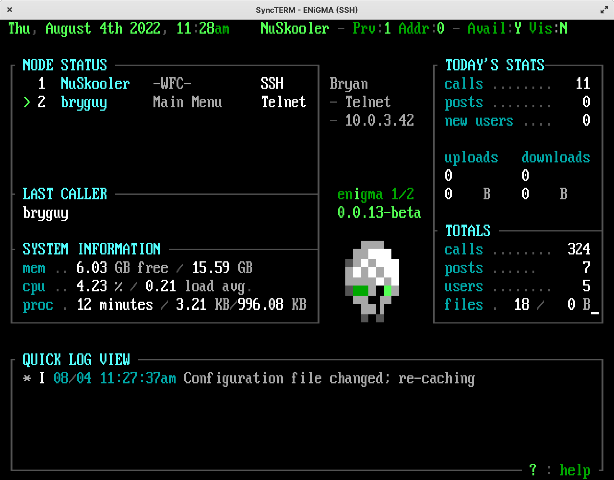

## The Waiting For Caller (WFC) Module
The `wfc.js` module provides a Waiting For Caller (WFC) type dashboard from a bygone era. Many traditional features are available including newer concepts for modern times. Node spy is left out as it feels like something that should be left in the past.

<br/>

## Accessing the WFC
By default, the WFC may be accessed via the `!WFC` main menu command when connected over a secure connection via a user with the proper [ACS](../configuration/acs.md). This can be configured as per any other menu in the system. Note that ENiGMA½ does not expose the WFC as a standalone application as this would be much less flexible. To connect locally, simply use your favorite terminal or for example: `ssh -l yourname localhost 8889`. See **Security** below for more information.

## Security
The system allows any user with the proper security to access the WFC / system operator functionality. The security policy is enforced by ACS with the default of `SCAF2ID1GM[wfc]`, meaning the following are true:

1. Securely Connected (such as SSH or Secure WebSocket, but not Telnet)
2. [Auth Factor 2+](user-2fa-otp-config.md). That is, the user has 2FA enabled.
3. User ID of 1 (root/admin)
4. The user belongs to the `wfc` group.

:::note
Due to the above, the WFC screen is **disabled** by default as at a minimum, you'll need to add your user to the `wfc` group. See also [Security](../configuration/security.md) for more information on keeping your system secure!
:::

Adding your user to the `wfc` group:
```bash
# Replace USERNAME with your leet +op username
./oputil.js user group USERNAME "+wfc"
```

To change the ACS required, specify an alternative `acs` in the `config` block. For example:
```hjson
mainMenuWaitingForCaller: {
    config: {
        // initial +op over secure connection only
        acs: ID1SC
    }
}
```

:::tip
You can add additional co-ops by adjusting the required ACS and/or adding them to a WFC-able group.
:::

:::caution
ENiGMA½ will enforce ACS of at least `SC` (secure connection)
:::

## Configuration
### Config Block
The WFC `config` block allows for the following keys:

| Key | Required | Description |
|-----|----------|-------------|
| `acs` | Yes | See [Security](#security) above. |
| `opVisibility` | No | Visibility on entering the WFC: `visible`, `hidden`, or `current` (default, leave as-is). `true`/`false` are accepted as aliases for `visible`/`hidden`. |
| `quickLogLevel` | No | Sets the log level for the quick log view. Defaults to `info`. See also [Monitoring Logs](../troubleshooting/monitoring-logs.md). |
| `art` | Yes | An object containing art specs: `main` for the WFC main view and `help` for a help screen. Optional: `fullLog`, `messages`, `tasks` and `taskPrompt` (see [Tasks](#tasks)). |
| `confirmKickNodePrompt` | No | Override the prompt name used for the "Kick selected node?" prompt. Defaults to `confirmKickNodePrompt`. |
| `pageIndicator` | No | String shown in the node list for nodes with a pending sysop chat page. Defaults to `!`. |
| `chatMenuName` | No | Override the menu name used for sysop chat. Defaults to `sysopChat`. |
| `nodeMessageMenuName` | No | Menu used by `S` (send) and `R` (reply). Defaults to `wfcNodeMessage`, the +op-side copy of `nodeMessage` — separate so the sysop path can be themed without changing what users see. |
| `notifications` | No | Where each kind of notification goes while you are at the WFC. See [Notifications](#notifications) below. |
| `inboxMaxItems` | No | How many messages the inbox holds before evicting. Read items are evicted before unread. Defaults to `50`. |
| `messageAlert` | No | Boolean. Send a BEL when a message arrives. Defaults to `true`. |
| `messagePreviewLength` | No | Max length of `{pendingNodeMessagePreview}`. Defaults to `40`. |
| `messageListFormat` | No | Format for each row of the message list. Tokens below. |
| `messageDetailFormat` | No | Format for the detail pane. Defaults to `{text}`. |
| `noMessagesText` | No | Shown when the inbox is empty. |
| `unreadIndicator` | No | Value of the `{unreadIndicator}` message token for an unread message; empty once read. Defaults to `*`. |
| `statusBar<Name>Format` | No | Format for the `%SB5` panel named `<name>`, e.g. `statusBarUserFormat` for a panel named `user`. See [Status Bar](#status-bar) below. |
| `statusBar<Name>ActiveFormat` | No | Used instead of `statusBar<Name>Format` while the panel's `{count}` is above zero. |
| `statusBarFormat` | No | One-line header for an `%SB5` with no `panels` and no `text` of its own. See [Status Bar](#status-bar) below. |
| `ticker` | No | Activity marquee config. See [Activity Ticker](#activity-ticker) below. |
| `hideCursor` | No | Boolean. Hide the terminal cursor while on the dashboard, which otherwise parks wherever the last refresh finished drawing. Defaults to `true`. |
| `taskListFormat` / `taskListFocusFormat` | No | Row formats for the task list. See [Tasks](#tasks) below. |
| `taskDateTimeFormat` | No | Date/time format for `{nextRun}`, `{lastRunAt}` and friends on the task screen. Defaults to the theme's short date/time format. |
| `taskStatusIndicators` | No | Map of task status (`running`, `overdue`, `failed`, `ok`, `never`) to the `{statusIndicator}` shown for it. Defaults to `*`, `!`, `X`, `+`, `-`. |
| `taskManualScheduleText` | No | `{schedule}` of a task without one. Defaults to `manual`. |
| `taskNoNextRunText` | No | `{nextRun}` of a task that is not scheduled. Defaults to `-`. |
| `taskNeverRunText` | No | `{lastRunAt}` and `{lastResult}` of a task that has not run. Defaults to `never`. |
| `taskDetailFieldFormat` | No | Format of each line in the task detail pane. Tokens: `{name}`, `{sep}`, `{value}`. Defaults to `\|08{name}\|07{sep}{value}`. |
| `noTasksText` | No | Shown in the detail pane when there are no tasks. |
| `runTaskPromptFormat` | No | The question asked before running a task with `confirm: true`. Row tokens. Defaults to `Run {desc}?`. |
| `stopTaskPromptFormat` | No | The question asked before stopping a task. Row tokens. Defaults to `{stopVerb} {desc}?`. |
| `taskStopVerbs` | No | `{stopVerb}` for a task whose process can be killed (`kill`) and for one that can only be abandoned (`abandon`). Defaults to `Kill` and `Abandon`. |
| `taskPromptSuffix` | No | Added after the question in the plain text prompt used without `taskPrompt` art. Defaults to `\|08[\|15y\|08/\|15N\|08]\|07`. |
| `taskActionResultFormats` | No | Map of a run or stop result (`started`, `alreadyRunning`, `disabled`, `unknown`, `killed`, `abandoned`, `notRunning`, `unavailable`) to the message shown for it. Tokens: `{name}`, `{desc}`, `{status}`. |


## Notifications
An +op sitting at the WFC is a node like any other, so achievements, node messages and time warnings are all aimed at their terminal. Painting any of those over the dashboard would corrupt it, so each kind is **routed** instead of displayed.

Routing is per notification type, and each type names zero or more *sinks*:

| Sink | Effect |
|------|--------|
| `inbox` | Held for you to read with the message key. Sends a BEL unless `messageAlert` is `false`. |
| `statusBar` | Surfaces as a count in a `%SB5` panel. |
| `log` | Rely on the log and surface nothing further here. Achievements are logged by the achievement subsystem for every op, not only one sitting at the WFC, so this sink means "it is already in the quick log and full log viewers". |
| `ticker` | Fed to a `%TK` ticker. |
| `interrupt` | Fall through to normal behaviour — displayed full screen with a pause. |

Defaults:

| Type | Default sinks | Why |
|------|---------------|-----|
| `nodeMsg` | `inbox`, `statusBar` | Read them when you choose to. |
| `achievement` | `log` | Decorative; the log already shows it. |
| `achievementGlobal` | `log` | As above — a busy board earns a lot of these. |
| `sysopPage` | *(none)* | Already surfaced via `{pendingPage*}` and the node list indicator. |
| `timeWarning` | *(none)* | Sysops are typically unlimited. |
| `system` | `interrupt` | Anything untagged behaves exactly as before. |

Override in the WFC `config` block:

```hjson
notifications: {
    nodeMsg: {
        sinks: [
            inbox
            statusBar
        ]
    }
    achievementGlobal: {
        sinks: [
            ticker
        ]
    }
}
```

:::caution
HJSON will not accept bare words sharing a line inside `[ ]` — `sinks: [ inbox, statusBar ]` fails to parse. Keep one per line, or quote each element.
:::

## Activity Ticker
Add a `%TK6` ticker to the WFC art and it becomes a board activity marquee, fed from the same system events that drive each user's log.

```hjson
ticker: {
    //  'cycle' advances when the ticker finishes a pass, so a message is
    //  never cut off. A number of milliseconds uses a timer instead.
    rotateOn: "cycle"
    maxItems: 10
    idleText: "{boardName} - {totalCalls} calls, {callsToday} today"
    events: {
        userLogin:             "|15{userName}|07 logged in on node |15{nodeId}|07"
        userAchievementEarned: "|15{userName}|07 earned |14{title}|07 (+{points})"
        userUpload:            "|15{userName}|07 uploaded |15{fileCount}|07 file(s)"
    }
}
```

Available event keys: `userLogin`, `userLogoff`, `userUpload`, `userDownload`, `userPostMessage`, `userSendMail`, `userRunDoor`, `userSendNodeMsg`, `userAchievementEarned`, and for [scheduler tasks](#tasks) `taskStarted`, `taskFinished`, `taskFailed` and `taskOverdue`. **An event with no format string is not shown**, so the noisier ones are opt-in. The three above are shown by default, and so are `taskFailed` and `taskOverdue`.

`taskFailed` is not an event of its own: it is a `taskFinished` whose run failed, shown with the `taskFailed` format in place of the `taskFinished` one. Set `taskFailed` to `""` and a failure is shown with the `taskFinished` format, if that is set. Starts and successful finishes are off by default because a task scheduled every hour would fill the marquee with them.

Format tokens: `{userName}`, `{realName}`, `{nodeId}`, `{title}`, `{points}`, `{achievementTag}`, `{areaTag}`, `{doorTag}`, `{fileCount}`, `{minutesOnline}`, `{boardName}`. Task events add `{taskName}`, `{taskDesc}`, `{reason}`, `{byUser}`, `{error}`, `{duration}`, `{durationMs}` and `{timeoutMs}`, and a finished one `{stoppedBy}`, `{exitCode}` and `{signal}`. `idleText` is formatted against the same custom MCI values as the rest of the dashboard.

Routing a notification type to the `ticker` sink puts it on the marquee too.

:::note
`rotateOn: "cycle"` relies on the ticker's `cycle complete` event. Every motion fires it for both short and long text; `bounce` with text that fits the view does not move, and instead rotates every `holdTicks` ticks. Quote the value — an unquoted HJSON string swallows a trailing `//` comment, so `rotateOn: cycle // note` silently becomes the whole line.
:::

## Node Messages
With the default key bindings:

| Key | Action |
|-----|--------|
| `M` | Open the message viewer |
| `S` | Send a node message to the node selected in `VM1`. Selecting your own node sends to `-ALL-`. |

Inside the viewer: `R` replies to the sender, `D` or `DEL` dismisses, `ESC`/`Q` returns to the dashboard.

Both `S` and `R` go to `wfcNodeMessage` rather than the user-facing `nodeMessage`. It is the same module and form, shipping with the same art, but as its own menu entry you can retheme or reconfigure it without affecting the `msg` command users see. Override with `nodeMessageMenuName`.

:::note
Break-into-chat deliberately does **not** get its own menu. `sysopChat` is entered by *both* parties with a `role` in `extraArgs`, so it is genuinely shared rather than a sysop-side screen.
:::

The viewer uses the `messages` art spec with `%VM1` (list) and `%MT2` (detail). **If that art is missing, a plain text list is shown instead**, so the feature works before a theme provides art.

Message list and detail format tokens: `{index}`, `{id}`, `{userName}`, `{realName}`, `{nodeId}`, `{type}`, `{read}`, `{unreadIndicator}`, `{timestamp}`, `{text}`. `{unreadIndicator}` is `unreadIndicator` (default `*`) for an unread message and empty once it has been read; pad it, e.g. `{unreadIndicator:<1}`, to keep columns aligned.

Each list item's `text` is replaced with `messageListFormat` before `%VM1` formats it. To lay a row out with `%VM1`'s own `itemFormat` / `focusItemFormat` instead, set `messageListFormat: "{text}"` so `{text}` stays the bare message. `messageListFormat` also formats the plain text fallback list.

## Status Bar
Add a `%SB5` to the WFC art for a status bar. Give it **panel mode** — a `panels` array in its MCI config — for full control: a panel's own `text` template cannot see WFC values, so each panel is filled from code instead. The menu template ships a minimal `SB5` with `messages` and `pages` panels, so placing `%SB5` in art works with no further config.

An `SB5` with no `panels` and no `text` of its own — for example in a theme without its own `wfc.ans`, which then gets the default theme's art but none of its config — shows the whole header as one line from `statusBarFormat`. The default is `{now}  {currentUserName}  Prv:{newPrivateMail} Addr:{newMessagesAddrTo}  Avl:{availIndicator} Vis:{visIndicator}  Msg:{pendingNodeMessageCount} Page:{pendingPageCount}`. An `SB5` that has a `text` template of its own, such as a clock, is left alone.

Every named panel is filled from `statusBar<Name>Format` (the panel name with its first letter upper-cased), formatted against the same values as custom MCI 10+ (see [Theming](#theming)) plus `{count}`:

| Panel | `{count}` | Default format |
|-------|-----------|----------------|
| `messages` | Unread messages in the inbox | `MSG {count}` |
| `pages` | Pending sysop pages | `PAGE {count}` |
| `tasks` | Running [scheduler tasks](#tasks) | `TASK {count}` |
| any other | `0` | *(none)* |

While `{count}` is above zero, `statusBar<Name>ActiveFormat` is used instead if set, so a panel can light up when something is waiting. A panel with no format at all is left alone, so a static `text` label panel keeps working. The messages count updates the moment a message arrives, and the tasks count the moment a task starts or finishes; everything else follows the dashboard's 5 second refresh.

Neither the menu template nor `luciano_blocktronics` has a `tasks` panel: luciano's 78 columns are spoken for. To add one, give it a slot in your `SB5` panels, for example `{ name: tasks, width: 7 }`, and optionally `statusBarTasksFormat` / `statusBarTasksActiveFormat`.

```hjson
config: {
    nowDateTimeFormat: "|10ddd MMM Do|08, |10h|08:|10mm|02a"
    statusBarNowFormat: "{now}"
    statusBarUserFormat: "|10{currentUserName}"
    statusBarMailFormat: "|02Prv|08:|10{newPrivateMail} |02Addr|08:|10{newMessagesAddrTo}"
    statusBarMessagesFormat: "|02MSG|08:|02{count}"
    statusBarMessagesActiveFormat: "|14MSG|08:|15{count}"
    statusBarPagesFormat: "|02PAGE|08:|02{count}"
    statusBarPagesActiveFormat: "|13PAGE|08:|15{count}"
}
0: {
    mci: {
        SB5: {
            width: 78
            separator: " "
            panels: [
                {
                    name: now
                    width: 21
                }
                {
                    name: user
                    width: fill
                }
                {
                    name: mail
                    width: 14
                }
                {
                    name: messages
                    width: 7
                }
                {
                    name: pages
                    width: 7
                }
            ]
        }
    }
}
```

A theme's `panels` array replaces the menu's wholesale. See [Status Bar View](../art/views/status_bar_view.md) for per-panel options (`justify`, `styleSGR1`, `fillChar`, `overflow`, ...).

## Theming
The following MCI codes are available:
* `VM1`: Node status list with the following format items available:
    * `text`: Username or `*Pre Auth*`.
    * `action`: Current action/menu.
    * `affils`: Any affiliations for the authenticated user, else "N/A".
    * `authenticated`: Boolean whether the node is authenticated (logged in) or not.
    * `availIndicator`: Availability indicator. Displayed via `statusAvailableIndicators` or system theme. See also [Themes](../art/themes.md).
    * `isAvailable`: Boolean whether the node is available (e.g. for messaging) or not.
    * `isSecure`: Is the node securely connected (e.g. SSL/SSH)?
    * `isVisible`: Boolean whether the node is visible to others or not.
    * `node`: The node ID.
    * `pageIndicator`: Non-empty when the node has a pending sysop chat page. Defaults to `!`. Override with `pageIndicator` in the WFC `config` block.
    * `realName`: Real name of authenticated user, or "N/A".
    * `remoteAddress`: A friendly formatted remote address such as an IPv4 or IPv6 address.
    * `serverName`: Name of connected server such as "Telnet" or "SSH".
    * `timeOn`: How long the node has been connected.
    * `timeOnMinutes`: How long in **minutes** the node has been connected.
    * `userId`: User ID of authenticated node, or 0 if not yet authenticated.
    * `userName`: User name of authenticated user or `*Pre Auth*`.
    * `visIndicator`: Visibility indicator. Displayed via `statusVisibleIndicators` or system theme. See also [Themes](../art/themes.md).
* `VM2`: Quick log with the following format keys available:
    * `timestamp`: Log entry timestamp in `quickLogTimestampFormat` format.
    * `level`: Log entry level from Bunyan.
    * `levelIndicator`: Level indicators can be overridden with the `quickLogLevelIndicators` key (see defaults below).
    * `quickLogLevelIndicators`: A **map** defaulting to the following:
        * `trace`: `T`
        * `debug`: `D`
        * `info`: `I`
        * `warn`: `W`
        * `error`: `E`
        * `fatal`: `F`
    * `nodeId`: Node ID.
    * `sessionId`: Session ID.
    * `quickLogLevelMessagePrefixes`: A **map** of log level names (see above) to message prefixes. Commonly used for changing message color with pipe codes, such as `|04` for red errors.
    * `message`: Log message.
* `MT3` or `ET3`: Selected node status information. May be a single or multi-line view.
    * Set `nodeStatusSelectionFormat` to the format desired, using `\n` for line feeds in an `MT` view. The available format keys are the same as the node status list above.
* `SB5`: Optional status bar in panel mode. Each named panel is filled from `statusBar<Name>Format`. See [Status Bar](#status-bar) above.
* `TK6`: Optional activity ticker. See [Activity Ticker](#activity-ticker) above.
* MCI 10...99: Custom entries with the following format keys available (also available to `%SB5` panel formats and ticker `idleText`):
    * `boardName`: The board name from `general.boardName`.
    * `nowDate`: Current date in the `dateFormat` style, defaulting to `short`.
    * `nowTime`: Current time in the `timeFormat` style, defaulting to `short`.
    * `now`: Current date and/or time in `nowDateTimeFormat` format.
    * `processUptimeSeconds`: Process (the BBS) uptime in seconds.
    * `totalCalls`: Total calls to the system.
    * `totalPosts`: Total posts to the system.
    * `totalUsers`: Total users on the system.
    * `totalFiles`: Total number of files on the system.
    * `totalFileBytes`: Total size in bytes of the file base.
    * `callsToday`: Number of calls today.
    * `postsToday`: Number of posts today.
    * `uploadsToday`: Number of uploads today.
    * `uploadBytesToday`: Total size in bytes of uploads today.
    * `downloadsToday`: Number of downloads today.
    * `downloadBytesToday`: Total size in bytes of downloads today.
    * `newUsersToday`: Number of new users today.
    * `currentUserName`: Current user name.
    * `currentUserRealName`: Current user's real name.
    * `lastLoginUserName`: Last login username.
    * `lastLoginRealName`: Last login user's real name.
    * `lastLoginDate`: Last login date in `dateFormat` format.
    * `lastLoginTime`: Last login time in `timeFormat` format.
    * `lastLogin`: Last login date/time.
    * `totalMemoryBytes`: Total system memory in bytes.
    * `freeMemoryBytes`: Free system memory in bytes.
    * `systemAvgLoad`: System average load.
    * `systemCurrentLoad`: System current load.
    * `newPrivateMail`: Number of new **private** mail for current user.
    * `newMessagesAddrTo`: Number of new messages **addressed to the current user**.
    * `availIndicator`: Is the current user available? Displayed via `statusAvailableIndicators` or system theme. See also [Themes](../art/themes.md).
    * `visIndicator`: Is the current user visible? Displayed via `statusVisibleIndicators` or system theme. See also [Themes](../art/themes.md).
    * `processBytesIngress`: Ingress bytes since ENiGMA started.
    * `processBytesEgress`: Egress bytes since ENiGMA started.
    * `pendingPageCount`: Number of pending sysop chat pages across all nodes.
    * `pendingPageUser`: Username of the most recent pending page, or empty.
    * `pendingPageNode`: Node ID of the most recent pending page, or empty.
    * `pendingPageMessage`: Message/reason of the most recent pending page, or empty.
    * `pendingNodeMessageCount`: Number of **unread** messages in the inbox.
    * `pendingNodeMessageTotal`: Total messages in the inbox, read or not.
    * `pendingNodeMessageUser`: Username who sent the most recent unread message, or empty.
    * `pendingNodeMessageNode`: Node ID of that sender, or empty.
    * `pendingNodeMessagePreview`: Truncated text of that message. Length via `messagePreviewLength`.
    * `runningTaskCount`: Number of [scheduler tasks](#tasks) running now, including `manual: false` ones the task screen does not list.
    * `overdueTaskCount`: Number of running tasks past their `timeout`.


:::note
While [Standard MCI](../art/mci.md) codes work on any menu, they will **not** refresh. For values that may change over time, please use the custom format values above.
:::

## Tasks
<kbd>T</kbd> opens the task screen: the [event scheduler](../configuration/event-scheduler.md)'s events, to see how they last ran and to run or stop them by hand. Events with `manual: false` are not listed, and those with `enabled: false` do not exist as far as the scheduler is concerned.

| Key | Action |
|-----|--------|
| `Enter` / `R` | Run the selected task. A task with `confirm: true` asks first. |
| `X` | Stop the selected task's run: its process is killed, or a `@method`, which cannot be stopped, is abandoned. Always asks first. |
| `F` | Refresh now |
| `PgUp` / `PgDn` | Scroll the detail pane |
| `ESC` / `Q` | Back to the dashboard |

A task runs in the background on the server, as it would on its schedule, so you can go back to the dashboard while it runs; the quick log, the [ticker](#activity-ticker) and a `tasks` [status bar](#status-bar) panel follow it from there. The run is recorded with you as `byUser` and `wfc` as its reason, and the WFC logs who ran or stopped what from which node. The screen refreshes every second while any task is running, otherwise every 5 seconds, and at once when a task starts, finishes or goes overdue, or when an edit to `config.hjson` [changes the events](../configuration/event-scheduler.md#changing-events-while-running). A task removed from the config while it runs stays listed, marked as removed, until it finishes. The selection stays on the same task across refreshes.

The result of a run or stop (started, already running, killed, abandoned, ...) is put in `{taskActionResult}` for the custom views, or written at `%XY3` when the art shows no custom view with it.

### Art
The task screen uses the `tasks` art spec (form 5):

* `VM1`: the task list. Each row can use the tokens below, through `taskListFormat` and `taskListFocusFormat`, or else `VM1`'s own `itemFormat` and `focusItemFormat`.
* `MT2`: the selected task in full: description and schedule, next run, whether it is running (since when, overdue since when, and what stopping it would do), and its last run (start, duration, result and error, reason, who ran it, exit code or the signal that ended it, who stopped it, whether it overran) with the tail of its output. It is word-wrapped to the view's width.
* `XY3`: where the confirm prompt is drawn.
* MCI 10...99: custom entries formatted from `tasksInfoFormat10`, `tasksInfoFormat11` and so on, with `{taskCount}`, `{runningTaskCount}`, `{overdueTaskCount}`, `{failedTaskCount}`, `{selectedTaskName}`, `{selectedTaskDesc}`, `{taskActionResult}`, `{now}` and everything the dashboard's custom entries get.

One prompt serves both run and stop: the `taskPrompt` art spec (form 6), drawn at form 5's `%XY3`, with a `%TL2` that gets the question (`runTaskPromptFormat` or `stopTaskPromptFormat`) and a `%TM1` yes/no. Keep it to a single line.

**Without the `tasks` art a plain text list is shown instead**, with the same keys plus up/down or `1`-`9` to select, and without the `taskPrompt` art the question is asked on a plain `[y/N]` line. Both work before a theme has art for them.

Row tokens:

| Token | Value |
|-------|-------|
| `{index}` | 1-based position |
| `{name}` | The event's name |
| `{desc}` | Its `desc`, else its name |
| `{schedule}` | Its schedule, or `taskManualScheduleText` (`manual`) |
| `{nextRun}` | When it next runs on its schedule, in `taskDateTimeFormat`, or `taskNoNextRunText` (`-`) |
| `{status}` | `running`, `overdue`, `failed`, `ok` or `never` |
| `{statusIndicator}` | The `taskStatusIndicators` entry for `{status}` |
| `{lastRunAt}` | When the last run started, or `taskNeverRunText` (`never`) |
| `{lastResult}` | `ok`, `failed`, or `taskNeverRunText` |
| `{lastError}` | The last run's error, if it failed |
| `{duration}` / `{durationMs}` | How long the last run took, e.g. `4m 05s` / in milliseconds |
| `{byUser}` | Who ran it by hand, if anyone |
| `{reason}` | Why the last run ran (`Schedule`, `wfc`, ...) |
| `{exitCode}` | The last run's exit code, for an `@execute` |
| `{signal}` | The signal that ended the last run's process, e.g. `SIGHUP` when it was stopped; `{exitCode}` is then empty |
| `{stoppedBy}` | Who stopped the last run, if anyone |
| `{runCount}` | Runs since startup |
| `{running}` / `{overdue}` | Booleans |
| `{removed}` | Boolean: taken out of `config.hjson` while running; listed until the run finishes |
| `{startedAt}` / `{elapsed}` | When the current run started / how long it has been going |
| `{overdueSince}` | When the current run went past its `timeout` |
| `{stopAction}` / `{stopVerb}` | `kill` or `abandon` / the `taskStopVerbs` entry for it |

:::note
A `{elapsed}` in a row format makes the list redraw every second while a task runs; without it the list is redrawn only when something in it changes.
:::

## Sysop Chat / Break Into Chat
The WFC supports receiving pages from users and initiating chat with any connected node.

### Receiving a Page
When a user pages the sysop:
1. An alert is sent according to `sysopChat.pageAlert` in `config.hjson` — `bel` (default, sends `\x07` to sysop terminals), `none` (silent), or `command` (runs a shell command).
2. Sysops **not** at the WFC receive an interrupt notification with the user's name, node, and message.
3. Sysops **at** the WFC see the page reflected immediately via `pendingPageCount`, `pendingPageUser`, `pendingPageNode`, and `pendingPageMessage` custom tokens, plus a `pageIndicator` on the paging node's row in `VM1`. No duplicate interrupt is queued for them.

### Breaking Into Chat
With a node selected in `VM1`, press `B` to break into chat. If the selected node has a pending page, that session is accepted; otherwise a new sysop-initiated session is created. Both parties enter the `sysopChat` menu directly — no pre-chat confirmation is shown to the user.

### System Config (`sysopChat` block in `config.hjson`)

| Key | Default | Description |
|-----|---------|-------------|
| `pageCooldownMinutes` | `5` | Minimum minutes a user must wait between pages. |
| `pageAlert` | `bel` | Alert mode on page arrival: `bel` (sends `\x07` to sysop terminals), `none` (silent), or `command` (runs `pageAlertCommand`). |
| `pageAlertCommand` | `''` | Shell command run when `pageAlert` is `command`. Tokens: `{userName}`, `{nodeId}`, `{message}`. Example: `'notify-send "Page from {userName}" "{message}"'` |
