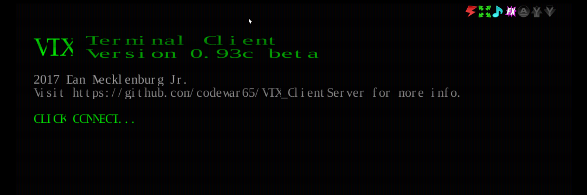

## WebSocket Login Server

The WebSocket Login Server provides **secure** (`wss://`) as well as non-secure (`ws://`) WebSocket login access. This is most commonly combined with a browser-based client such as [VTX](https://github.com/codewar65/VTX_ClientServer) or fTelnet to give users a web browser entry point to your BBS.

:::note
If you run into any trouble getting WebSocket or VTX set up, see [Troubleshooting WebSocket & VTX](../../troubleshooting/websocket-troubleshooting.md).
:::

:::tip[enig-term (preview)]
ENiGMA½ can also serve [enig-term](./enig-term.md), a browser terminal in development, at `/_enig/ws-term/` once you install its files. It connects to this server over `wss://`.
:::

---

## Configuration

Enable the WebSocket server by adding a `webSocket` block to `loginServers` in `config.hjson`:

```hjson
loginServers: {
    webSocket: {
        ws: {
            // non-secure ws:// — suitable for LAN/local testing or when
            // sitting behind a TLS-terminating reverse proxy (see below)
            port: 8810
            enabled: true

            // optional: bind to a specific address (e.g. loopback when proxied)
            address: 127.0.0.1
        }
        wss: {
            // secure wss:// — ENiGMA handles TLS directly
            port: 8811
            enabled: true
            certPem: /path/to/https_cert.pem
            keyPem:  /path/to/https_cert_key.pem
        }

        // Set proxied: true when a TLS-terminating reverse proxy (e.g. nginx)
        // forwards connections to ENiGMA's plain ws:// port.  From a trusted
        // proxy (see Trusted Proxies below), ENiGMA then takes the caller's
        // address from X-Forwarded-For / X-Real-IP, and treats a connection
        // carrying "X-Forwarded-Proto: https" as secure, which is required for
        // 2FA/OTP and other security-sensitive features.  Leave false
        // (default) if ENiGMA is exposed directly.
        proxied: true
    }
}
```

Restart ENiGMA and confirm the server started in the logs:

```
INFO: Listening for connections (server="WebSocket (insecure)", port=8810)
INFO: Listening for connections (server="WebSocket (secure)", port=8811)
```

---

## Deployment Architectures

There are two supported ways to expose a secure WebSocket endpoint to browser clients.

### Option A — Reverse Proxy (recommended)

A reverse proxy such as nginx or Caddy handles TLS and forwards plain `ws://` traffic to ENiGMA. This is the most common setup because it reuses your existing web certificate and keeps ENiGMA out of the certificate-management business.

```
Browser (wss://) → nginx (TLS termination) → ENiGMA ws:// port 8810
```

**ENiGMA config:**

```hjson
loginServers: {
    webSocket: {
        ws: {
            port: 8810
            enabled: true
            address: 127.0.0.1   // loopback only — nginx is the public face
        }
        proxied: true            // read forwarded headers from the proxy
    }
}
```

**nginx location block** (inside your existing `server { ... }` block with a valid TLS certificate):

```nginx
location /wss {
    proxy_pass         http://127.0.0.1:8810;
    proxy_http_version 1.1;
    proxy_set_header   Upgrade    $http_upgrade;
    proxy_set_header   Connection "Upgrade";
    proxy_set_header   Host       $host;
    proxy_set_header   X-Forwarded-For   $proxy_add_x_forwarded_for;
    proxy_set_header   X-Real-IP         $remote_addr;
    proxy_set_header   X-Forwarded-Proto https;
}
```

Point `wsConnect` in `vtxdata.js` to `wss://your-hostname.here/wss`.

See [nginx WebSocket proxying](https://nginx.org/en/docs/http/websocket.html) for more detail.

Caddy's `reverse_proxy` and Traefik set `X-Forwarded-For` and `X-Forwarded-Proto` by themselves.

### Trusted Proxies

Forwarded headers are believed only from the addresses in the top-level `trustedProxies` setting, which the [web server](../contentservers/web-server.md#reverse-proxies) uses too. The default covers loopback and the private ranges (`127.0.0.0/8`, `::1/128`, `10.0.0.0/8`, `172.16.0.0/12`, `192.168.0.0/16`, `fc00::/7`), so a proxy on the same host, in another Docker container or on the LAN needs no change. A proxy on any other address must be listed:

```hjson
trustedProxies: [
    "127.0.0.0/8"
    "::1/128"
    "203.0.113.10"
]
```

Entries are IPv4 or IPv6 addresses or CIDRs. Setting `trustedProxies` replaces the default list, so keep the entries you still need.

**The proxy must set `X-Forwarded-For` itself**, as in the nginx example above (`$proxy_add_x_forwarded_for` appends the address nginx sees, which is fine). A header the proxy passes through unchanged was written by the client.

With `proxied: true`:

* The caller's address comes from `X-Forwarded-For`, read right to left, skipping addresses that are themselves trusted proxies; failing that, from `X-Real-IP`.
* `X-Forwarded-Proto: https` marks the connection as secure.
* Forwarded headers from a peer not in `trustedProxies` are ignored. The log says so once per address, naming `trustedProxies`: if that address is your proxy, add it.
* Callers that come through the proxy are never treated as local, whatever address it forwards.
* If the proxy sends no client address, every caller appears to come from the proxy, and the log suggests sending `X-Forwarded-For`.

The `Forwarded` header (RFC 7239) is not read.

### Option B — ENiGMA handles TLS directly

ENiGMA listens on a dedicated `wss://` port and manages the certificate itself. Useful if you don't already run a reverse proxy.

```
Browser (wss://) → ENiGMA wss:// port 8811
```

**ENiGMA config:**

```hjson
loginServers: {
    webSocket: {
        wss: {
            port: 8811
            enabled: true
            certPem: /path/to/https_cert.pem
            keyPem:  /path/to/https_cert_key.pem
        }
    }
}
```

Point `wsConnect` in `vtxdata.js` to `wss://your-hostname.here:8811`.

:::caution
Let's Encrypt certificates are written to a privileged directory by default. If ENiGMA does not run as root (it shouldn't), copy the cert and key to a location readable by the ENiGMA user and keep them updated when the cert renews.
:::

---

## VTX Web Client

ENiGMA supports the [VTX WebSocket client](https://github.com/codewar65/VTX_ClientServer) for in-browser BBS access. Example deployment: [Xibalba](https://xibalba.vip).

:::caution
**Browsers require `wss://`** whenever the page itself is served over HTTPS. A browser will refuse to open a plain `ws://` connection from an HTTPS page (mixed-content policy). For any publicly accessible BBS whose VTX page is served over HTTPS, a secure WebSocket connection is **required**, not optional. Plain `ws://` is only practical for local/LAN testing where the page is also served over plain HTTP.
:::

### Setup

1. **Enable the WebSocket server** as described above. For a public deployment use Option A or B.

2. **Download VTX_ClientServer.** Visit [github.com/codewar65/VTX_ClientServer](https://github.com/codewar65/VTX_ClientServer) and download the release you intend to use. Unpack it to a temporary directory.

   :::note
   The `vtxdata.js` configuration format has changed across VTX_ClientServer releases. The example below matches current releases; if you download an older or newer version and see a black screen or a browser console error, check [Troubleshooting WebSocket & VTX](../../troubleshooting/websocket-troubleshooting.md).
   :::

3. **Download the example HTML file.** Save [vtx.html](https://raw.githubusercontent.com/NuSkooler/enigma-bbs/master/misc/vtx/vtx.html) to your webserver root.

4. **Create the asset directory structure:**

   ```text
   ├── assets
   │   └── vtx
   └── vtx.html
   ```

5. **Copy VTX client files.** From the unpacked VTX_ClientServer package, copy the contents of the `www` directory into `assets/vtx/`.

6. **Create `assets/vtx/vtxdata.js`:**

   ```javascript
   var vtxdata = {
       sysName:     "Your Awesome BBS",
       wsConnect:   "wss://your-hostname.here:8811",  // or wss://your-hostname.here/wss for Option A
       term:        "ansi-bbs",
       codePage:    "CP437",
       fontName:    "UVGA16",
       fontSize:    "24px",
       crtCols:     80,
       crtRows:     25,
       crtHistory:  500,
       xScale:      1,
       initStr:     "",
       defPageAttr: 0x1010,
       defCrsrAttr: ['thick', 'horizontal'],
       defCellAttr: 0x0007,
       telnet:      1,
       autoConnect: 0,
       wsProtocol:  'telnet',
       wsDataType:  'arraybuffer',
   };
   ```

   Update `sysName` and `wsConnect` for your system. Note that `defCrsrAttr` must be an **array**, not a hex value — passing a hex integer here causes a black screen.

7. **Navigate to** `https://your-hostname.here/vtx.html`. You should see a splash screen like:

   

---

## Configuration Reference

| Key | Required | Description |
|-----|----------|-------------|
| `ws.enabled` | | Enable non-secure `ws://` listener. Default: `false`. |
| `ws.port` | | Port for `ws://`. Default: `8810`. |
| `ws.address` | | Bind address for `ws://`. Omit to bind all interfaces. |
| `wss.enabled` | | Enable secure `wss://` listener. Default: `false`. |
| `wss.port` | | Port for `wss://`. Default: `8811`. |
| `wss.address` | | Bind address for `wss://`. |
| `wss.certPem` | Yes (if wss enabled) | Path to TLS certificate in PEM format. |
| `wss.keyPem` | Yes (if wss enabled) | Path to TLS private key in PEM format. |
| `proxied` | | Set `true` when behind a TLS-terminating proxy. Reads the caller's address and `X-Forwarded-Proto: https` from proxies in `trustedProxies`. Default: `false`. |

`trustedProxies` is a top-level setting, not part of the `webSocket` block: see [Trusted Proxies](#trusted-proxies).
